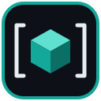

<p align="center">
  
</p>

<h1 align="center">C# Unity Utils</h1>

<p align="center">
  <a href="https://github.com/guavovic/csharp-unity-utils/releases/latest"></a>
  <a href="package.json"></a>
  <a href="LICENSE"></a>
</p>

<p align="center">Pacote de utilitários para Unity, tirados de projetos reais, para não reescrever o mesmo código a cada jogo novo.</p>

<p align="center">
  <b><a href="#instalação">Instalação</a></b>
  &nbsp;•&nbsp;
  <a href="#exemplos">Exemplos</a>
  &nbsp;•&nbsp;
  <a href="https://github.com/guavovic/csharp-unity-utils/releases/latest">Releases</a>
  &nbsp;•&nbsp;
  <a href="CONTRIBUTING.md">Como contribuir</a>
</p>

## Destaques

- **Atributos de inspector:** `[ReadOnly]`, `[Required]` e `[ShowIf]`, com os drawers no assembly de Editor, fora do build do jogo.
- **Cena arrastável:** o `SceneField` recebe o asset da cena no inspector e vira o nome dela no `SceneManager.LoadScene`.
- **Recarga pronta:** `Cooldown` serializável, com a duração no inspector, `TryUse` e opção de tempo sem escala.
- **Coroutines sem MonoBehaviour:** `CoroutineRunner.Run` e `RunAfter` funcionam a partir de qualquer classe.
- **PlayerPrefs tipados:** `TypedPlayerPrefs` guarda bool, enum e objeto como JSON.

## O que tem

| Área | Itens |
|---|---|
| Inspector | `[ReadOnly]`, `[Required]`, `[ShowIf]` e `SceneField` (arraste a cena e use o nome ou o caminho) |
| Jogo | `Singleton<T>`, `Cooldown`, `CoroutineRunner`, `SafeAreaFitter` e `FrameRateDisplay` |
| Dados | `TypedPlayerPrefs` (bool, enum e objeto como JSON), `ApplicationLanguageIdentifier` e `DateRegionConverter` |
| Extensões | `Vector2` e `Vector3`, `Transform`, `Color`, `LayerMask`, listas (`RandomElement`, `Shuffle`) e `MonoBehaviour` |
| Texto | `StringUtilities.FormatFieldName` |

## Instalação

No Unity, abra **Window > Package Manager > Add package from git URL** e use:

```
https://github.com/guavovic/csharp-unity-utils.git
```

## Exemplos

<details>
<summary><b>Inspector:</b> atributos e cena no inspector</summary>

```csharp
using GV.Extensions;
using UnityEngine;
using UnityEngine.SceneManagement;

public class Enemy : MonoBehaviour
{
    [Required, SerializeField] private Rigidbody2D _body;
    [ReadOnly, SerializeField] private int _health = 10;

    [SerializeField] private bool _hasShield;
    [ShowIf(nameof(_hasShield)), SerializeField] private float _shieldTime = 3f;

    [SerializeField] private SceneField _nextScene;

    private void Win() => SceneManager.LoadScene(_nextScene);
}
```

`[Required]` destaca a referência vazia, `[ReadOnly]` mostra o valor sem deixar editar, `[ShowIf]` esconde o campo até o bool ficar ligado e o `SceneField` aceita a cena arrastada e converte para o nome dela.

</details>

<details>
<summary><b>Jogo:</b> singleton, recarga e coroutines</summary>

```csharp
public class GameManager : Singleton<GameManager> { }

public class Gun : MonoBehaviour
{
    [SerializeField] private Cooldown _fireCooldown;

    private void Update()
    {
        if (Input.GetButton("Fire1") && _fireCooldown.TryUse())
            GameManager.Instance.SpawnBullet();
    }
}

CoroutineRunner.RunAfter(2f, () => Debug.Log("Dois segundos depois, sem precisar de MonoBehaviour"));
```

Para respeitar o notch do celular, coloque o `SafeAreaFitter` num painel que preenche o Canvas.

</details>

<details>
<summary><b>Dados e extensões:</b> PlayerPrefs, vetores, cores e listas</summary>

```csharp
TypedPlayerPrefs.SetBool("music", true);
Difficulty difficulty = TypedPlayerPrefs.GetEnum("difficulty", Difficulty.Normal);
TypedPlayerPrefs.SetObject("settings", settings);

transform.position = transform.position.WithY(0f);
spriteRenderer.color = spriteRenderer.color.WithAlpha(0.5f);

Card card = deck.RandomElement();
deck.Shuffle();

StringUtilities.FormatFieldName("playerMaxHP"); // "Player Max HP"
```

</details>

## Como foi feito

- C# em um pacote UPM para Unity 2021.3 ou mais novo, com os assemblies de Runtime e Editor separados por `asmdef`
- drawers do inspector no assembly de Editor, para o código de editor nunca entrar no build do jogo
- testes de edit mode e de play mode com NUnit e Unity Test Framework

> [!IMPORTANT]
> Contribuições são bem-vindas. Veja o [CONTRIBUTING.md](CONTRIBUTING.md).

---

<sub>Licença [MIT](LICENSE) · Feito por [Gustavo Victor](https://github.com/guavovic)</sub>
